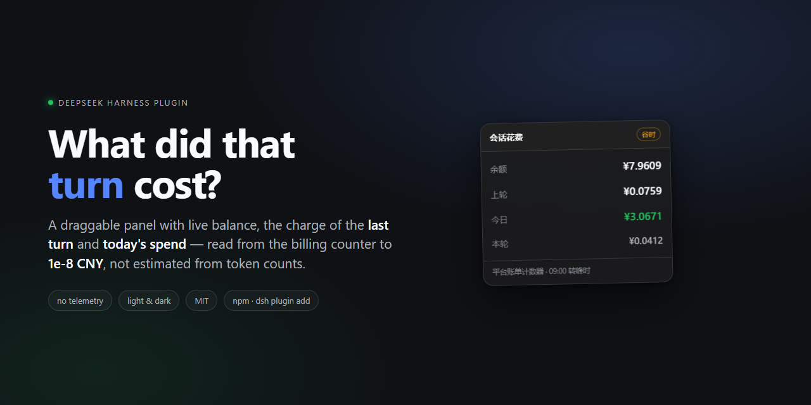
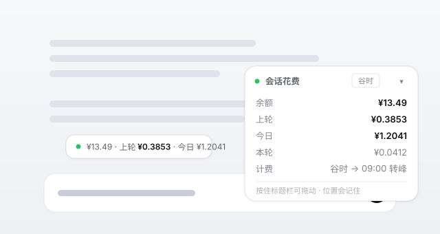

# dsh-spend-meter

[](https://github.com/lx950/dsh-spend-meter/actions/workflows/ci.yml)
[](https://github.com/lx950/dsh-spend-meter/stargazers)
[](LICENSE)
[](#privacy)

> Install straight from GitHub — no npm needed: `dsh plugin --profile <name> add
> github:lx950/dsh-spend-meter`. The package is called `dsh-spend-panel` internally
> (the plain `dsh-spend-meter` name is taken on npm), so that is the id you will see in
> `node_modules` and in `dsh.profile.bundles`.

**A small draggable panel** that tells you what you are spending: your account balance, the charge for the last turn, and today's total — read from your DeepSeek **billing counter** (1e-8 CNY), with the real rate card used only where the counter has not settled yet.





> *Schematic of the panel. It renders with the app's own design tokens — same font, radii, shadows and dark theme — and you can drag it anywhere, or collapse it to one line.*

```
会话花费                                  谷时  ▾
余额                    ¥9.6540
上轮                    ¥0.0759
今日                    ¥3.0671
本轮                    ¥0.0412
计费            谷时 → 09:00 转峰
```

## Why

DeepSeek Harness streams tokens, but it never tells you what a turn cost. Balance pages are a separate tab; the session transcript has token counts but no price. `dsh-spend-meter` closes that loop without leaving the conversation.

- **Balance** — the wallet balance from your signed-in DeepSeek account, with **8 decimals** (`platform.deepseek.com/api/v0/users/get_user_summary`). No more 2-decimal rounding. Falls back to `api.deepseek.com/user/balance` (API key), then to the host's account service.
- **Last turn** — what the provider **actually charged** for the most recent settled reply in *this* conversation: the difference of the lifetime spend counter across that turn. Long tool-calling turns are aggregated across every step, not just the last one. Until the counter settles (about a minute) the panel shows the rate-card estimate and says so in the tooltip.
- **Today** — `counter now − counter at this day's first reading`: what the day really cost. The part of the day before the plugin was watching is filled in from the host's own session transcripts, priced on the rate card and corrected by a self-calibrating measured/estimate ratio. Install the plugin at noon and today's number is still right.
- **Live** — while a turn is still running, `本轮` shows what it has cost so far.
- **Peak / off-peak** — DeepSeek bills 09:00–12:00 and 14:00–18:00 Beijing time at 2×, with weekends and statutory holidays off-peak all day. The panel shows which tier you are in and when it flips.
- **Honest when it fails** — if the balance cannot be read, the panel says which path failed and why, instead of silently showing a dash.

## Requirements

- DeepSeek Harness `0.2.0-rc.2` or newer, desktop profile (the panel is a client
  slot, so a plain `dsh` web session will not show it).
- **Node 22+ inside the host** for the transcript backfill (multi-frame zstd comes
  from `node:zlib`). On an older runtime the panel still works from the balance book;
  `diag.transcript.error` says why the backfill is off.

## Install

No npm package yet — install from GitHub:

```bash
dsh plugin --profile <name> add github:lx950/dsh-spend-meter
```

From a checkout (development, picks up edits without reinstalling):

```bash
dsh plugin --profile <name> add link:/absolute/path/to/dsh-spend-meter
```

Restart DSH. The panel appears in the conversation; drag it by its header, collapse it with the corner button. Position and collapsed state are remembered per machine (localStorage), so it stays where you put it.

> **Desktop app note:** the `desktop` profile is owned by the Electron shell, so a terminal `dsh plugin --profile desktop add …` is refused by design. Either install it from inside the app's plugin manager (if it lists GitHub sources), or edit `%USERPROFILE%\.dsh\profiles\desktop\package.json`:
>
> ```json
> {
>   "dependencies": { "dsh-spend-panel": "github:lx950/dsh-spend-meter" },
>   "dsh": { "profile": { "bundles": [ "... keep the existing rows ...", "dsh-spend-panel" ] } }
> }
> ```
>
> …then install inside that folder (`pnpm install`, or the app's bundled pnpm at `%USERPROFILE%\.dsh\dsh-runtimes\dsh-primary-runtime\dependencies\pnpm\bin\pnpm.cjs`) and restart the app. Details in [DEVELOPMENT.md](DEVELOPMENT.md).

## How the number is computed

Tokens come from the host's own usage events — the same `inputTokens` / `cacheReadTokens` / `outputTokens` that DSH reports per assistant step. Reasoning tokens are already included in `outputTokens` and are never added twice.

```
cost = cache ÷ 1e6 × hit  +  input ÷ 1e6 × miss  +  output ÷ 1e6 × out
```

Prices, CNY per 1M tokens:

| model | cache hit | cache miss | output |
| --- | --- | --- | --- |
| `deepseek-flash`, `deepseek-v4-flash`, `deepseek-v4-flash-vision-exp` | 0.02 / 0.04 | 1 / 2 | 4 / 8 |
| `deepseek-v4-pro` | 0.15 / 0.3 | 4.5 / 9 | 13.5 / 27 |

`off-peak / peak`. Unknown model ids fall back to the Flash card. Peak windows: 09:00–12:00 and 14:00–18:00 Beijing time, weekdays; weekends and statutory holidays are off-peak all day.

This is an estimate at *list prices* — used only where the real counter cannot speak: before a running turn settles, and for usage that happened before the plugin was watching. If DeepSeek changes the rate card, `lib/pricing.js` is one object to edit (PRs welcome, especially the annual holiday table).

### The billing counter

The account page knows the exact number, and so does this plugin. The Platform summary endpoint returns a **lifetime spend counter** (`total_costs`) that only ever grows:

```
GET https://platform.deepseek.com/api/v0/users/get_user_summary
x-dsh-auth-token: <the grant DSH already holds for platform.deepseek.com>
```

```json
{"code":0,"data":{"biz_data":{
  "normal_wallets":[{"currency":"CNY","balance":"9.9948816200000000"}],
  "total_costs":[{"currency":"CNY","amount":"71.6670811400000000"}]}}}
```

Every money number in the panel is a difference of that counter:

| number | how it is derived |
| --- | --- |
| last turn | counter at the end of the turn − counter before it |
| today | counter now − counter at this day's first reading (+ transcript backfill) |
| balance | `normal_wallets.balance`, 8 decimals |

Because it is a *charge* counter, top-ups and bonus grants cannot confuse it — they move the wallet balance, never `total_costs`. Deltas are always `≥ 0`, so a refund or a counter reset never shows up as negative spend. Settlement is not instant: DeepSeek posts a turn's charge roughly a minute after it finishes, so the panel polls fast (2 s) for the first 20 s after a turn and then backs off (6 s, up to two minutes) until the counter moves. Charges that arrive while no turn is waiting are recorded as `unattributed` and still land in today's total.

### Two books, one number

| book | source | what it is good for |
| --- | --- | --- |
| counter | `total_costs` deltas from the Platform summary | what the account was **actually** charged, 1e-8 CNY, immune to top-ups |
| transcript | `$DSH_HOME/sessions/**/session.v4.jsonl.zstd`, the host's own append-only record | the whole day, including usage from before the plugin was running or from before a restart |

Today = counter delta since this day's first reading + transcript estimate before that reading. When the account grant is missing the panel falls back to a wallet-balance delta, and then to the estimate alone, saying which one it used in the tooltip. Neither book is ever lowered by the other: repairs only ever add missing usage.

## Config

```yaml
- insert:
    - id: dsh-spend-panel
      name: dsh-spend-panel
      config:
        ledgerFile: /custom/path/ledger.json   # default: $DSH_HOME/spend-meter/ledger.json
        balanceRefreshMs: 60000                # balance poll interval
        balanceTtlMs: 45000                    # how long one balance reading is reused
        transcriptSyncMs: 30000                # transcript reconciliation interval
        sessionsRoot: /custom/sessions         # default: $DSH_HOME/sessions
```

Environment:

| variable | effect |
| --- | --- |
| `DSH_SPEND_METER_ALLOW_REMOTE=1` | let non-loopback clients read the routes (default: loopback only) |

## Routes

The panel is a plain same-origin poll; nothing else is smuggled over it. The host serves these over its Fetch route channel (`connection.fetch.register`), which is what first-party page requests already travel on, so the panel inherits the app's own request fence.

```
POST api/dsh-spend/state    {"session":"<id>"}  live state for one conversation
POST api/dsh-spend/days     {"limit":30}        the day ledger, oldest first
POST api/dsh-spend/health   {}                  liveness, ledger path, balance source
```

Read-only GET aliases exist for `curl` and for hosts without the Fetch channel:

```
GET /api/dsh-spend/state?session=<id>
GET /api/dsh-spend/days?limit=30
GET /api/dsh-spend/health
```

## Troubleshooting

Every refresh records what happened to `$DSH_HOME/spend-meter/diag.json`:

```json
{
  "version": "0.4.4",
  "routes": { "fetch": ["/api/dsh-spend/state", "…"], "http": ["…"] },
  "services": { "credentials": "inject", "deepseekAccount": "inject" },
  "platform": { "ok": true, "balance": 9.65402082, "totalCosts": 72.00794194, "error": null, "credentialSource": "service" },
  "balance": { "apiKey": { "ok": true, "keySource": "service", "error": null }, "account": { "service": false } },
  "lastSession": { "raw": "session-4f2a…", "key": "4f2a…", "scope": "session", "known": 2 },
  "transcript": { "day": "2026-10-29", "files": 5, "amount": 2.6228, "before": 2.6228, "after": 0.34 },
  "events": 128,
  "polls": 41
}
```

Reading it answers the two questions worth asking: *is the panel reaching the plugin* (`polls` climbing) and *which balance path failed* (`balance.*` / `platform.error`). Both halves are also visible in the panel itself. `platform.credentialSource` says where the account grant came from: `service` (host credentials service) or `file` (`$DSH_HOME/.credentials.yaml`, used when the injected service is scoped so tightly that it answers "nothing stored"). `lastSession.scope` says whether "last turn" came from this conversation (`session`), from the session that last produced an event (`active`) or from the newest-turn fallback (`recent`) because the host did not hand over a usable id — the panel then says so in its tooltip instead of showing a dash. `lastSession.source` and the sibling `probe` block record which prop supplied the id (`props.session.id`, `props.sessionId`, …) and the prop keys the slot actually received, so a "wrong conversation" report can be answered from the file rather than guessed at.

## Privacy

The ledger stays on your machine (`$DSH_HOME/spend-meter/ledger.json`). The plugin talks to exactly two DeepSeek endpoints — `platform.deepseek.com/api/v0/users/get_user_summary` for the billing counter, and `api.deepseek.com/user/balance` as a fallback — using the grant / API key already stored in DSH credentials, and only when it needs a number. If the injected credentials service reports nothing, the same values are read (never written, never logged) from `$DSH_HOME/.credentials.yaml`. No telemetry, no third-party calls, no prompt or message content is ever stored.

## Limitations

- Prices are a local table; a changed rate card needs a release (or a config override — see `PRICING`).
- Settlement lags: a turn's charge shows up in the counter about a minute later. A charge that lands after the next turn has started is attributed to that newer turn (never lost, but the per-turn split can be off by one).
- Money charged while no turn was waiting (subagents, background calls) is recorded as `unattributed`: it is included in today, not attributed to a turn.
- Today's backfill (the part of the day the plugin did not watch) is priced at list prices and corrected by the measured/estimate ratio — very close, not exact.
- `lastTurn` is per session. Switch conversations and it switches with you — that is the point.
- The 8-decimal counter needs the signed-in account grant. Without it the panel degrades to the API-key balance (2 decimals) or the host account service, and says so.
- Peak/off-peak follows the published Beijing schedule; official holiday shifts are listed in `HOLIDAY_VALLEY` and extended once a year.

## Development

```bash
npm test                       # 28 assertions + apply-smoke + platform-e2e + today-e2e
                               # + session-id + credentials-e2e (offline, stubs only)
npm run test:live              # one real balance read through the plugin's own code
npm run test:live:platform     # real Platform summary: 8-decimal balance + lifetime counter
npm run test:preview           # print the exact numbers the panel would render
```

No build step: `lib/client.js` is already in the host's `__ModuleLoader__` factory format, and the host serves it as-is.

- [DEVELOPMENT.md](DEVELOPMENT.md) — layout, host contracts this plugin relies on, diagnostics reference, test strategy
- [CONTRIBUTING.md](CONTRIBUTING.md) — the five contracts worth not breaking, and two testing traps
- [CHANGELOG.md](CHANGELOG.md) — every release and the bug behind it
- [PUBLISHING.md](PUBLISHING.md) — step-by-step upload checklist (this file is for the maintainer)
- [docs/announcement.md](docs/announcement.md) — announcement copy, if you want to share it

MIT licensed.


---

## 中文

**一个可拖动的小面板，告诉你花了多少：** 账户余额、上一轮的扣费、今天的总额 —— 直接读 DeepSeek **账单计数器**（1e-8 元精度），计数器还没结算时才用真实价目表兜底。

```
会话花费                                  谷时  ▾
余额                    ¥9.6540
上轮                    ¥0.0759
今日                    ¥3.0671
计费            谷时 → 09:00 转峰
```

安装（暂时没有 npm 包，直接从 GitHub 装）：

```bash
dsh plugin --profile <name> add github:lx950/dsh-spend-meter
```

- **余额**：宿主已登录账号的 DeepSeek 钱包余额，**8 位小数**（`platform.deepseek.com/api/v0/users/get_user_summary`）；失败时回退 API key 的 `/user/balance`（2 位小数），再回退账号服务。
- **上一轮**：当前会话里最近一次已结算回复**实际被扣的钱** —— 终身消费计数器在该轮前后的差额；带工具调用的长回合会把每一步累加。计数器还没结算（约 1 分钟）时先显示价目表估算，并在悬浮提示里说明。
- **今日**：`现在计数器 − 当天首次读到的计数器`，即这天真实花掉的；插件没看到的时段用宿主自己的会话 transcript 按价目表补算，并用实测/估算比值自校准。中午才装上也依然对得上。
- **本轮**：回合进行中时显示它已经花掉多少。
- **峰 / 谷**：北京时间 09:00–12:00、14:00–18:00 为峰时（2 倍价），周末与法定节假日全天谷时。

面板按 DSH 自身的设计变量渲染（同一套字体、圆角、阴影、暗色主题）：按住标题栏拖动，右上角收起成一行，位置与折叠状态记在本机。计价公式与价目表见[英文部分](#how-the-number-is-computed)。

余额读不到时不会静默显示 `—`，面板会写明是哪条路失败、为什么；对应细节同时写进 `$DSH_HOME/spend-meter/diag.json`。账本只存在本机 `$DSH_HOME/spend-meter/ledger.json`；插件只访问 DeepSeek 自己的余额接口，不上报任何数据，也不保存对话内容。

开发与发布：[DEVELOPMENT.md](DEVELOPMENT.md)（宿主契约、诊断字段、测试策略）· [CONTRIBUTING.md](CONTRIBUTING.md)（贡献须知）· [CHANGELOG.md](CHANGELOG.md)（每个版本的修复由来）。
